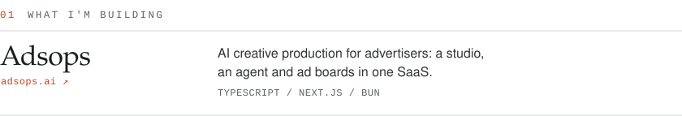
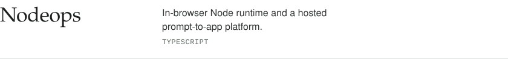
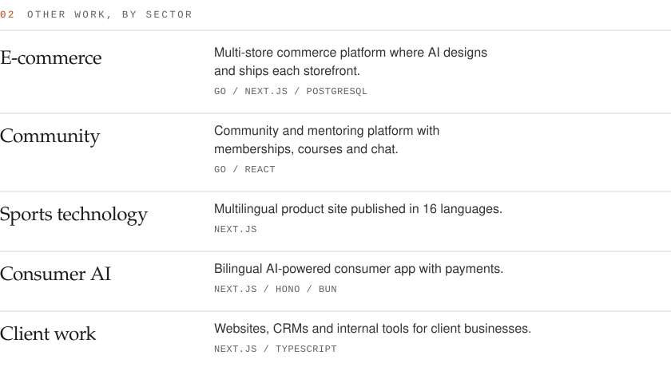
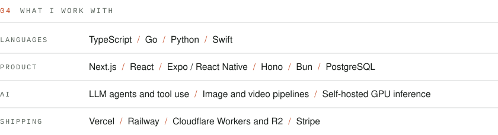
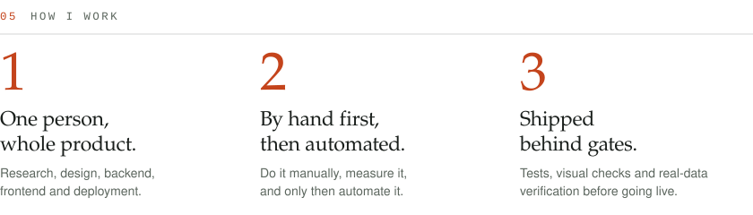

<picture>
  <source media="(prefers-color-scheme: dark)" srcset="assets/header-dark.svg">
  
</picture>

  

<a href="https://adsops.ai">
<picture>
  <source media="(prefers-color-scheme: dark)" srcset="assets/adsops-dark.svg">
  
</picture>
</a>

<picture>
  <source media="(prefers-color-scheme: dark)" srcset="assets/nodeops-dark.svg">
  
</picture>

  

<picture>
  <source media="(prefers-color-scheme: dark)" srcset="assets/sectors-dark.svg">
  
</picture>

  

<picture>
  <source media="(prefers-color-scheme: dark)" srcset="assets/stack-dark.svg">
  
</picture>

  

<picture>
  <source media="(prefers-color-scheme: dark)" srcset="assets/principles-dark.svg">
  
</picture>

 

<b>Türkçe</b>

 

Yapay zekâ odaklı ürünleri uçtan uca geliştiriyorum: model hattından yayındaki arayüze kadar.
İstanbul'da çalışan bir ürün mühendisiyim. İşlerimin çoğu özel depolarda duruyor; bu sayfa onların haritası.

**Üzerinde çalıştıklarım:** [Adsops](https://adsops.ai) (reklamverenler için yapay zekâ ile kreatif üretim) ve Nodeops (tarayıcı içi Node çalışma zamanı ve istemden uygulamaya platform).

**Sektör bazında diğer işler:** e-ticaret (her mağazayı yapay zekânın tasarladığı çok mağazalı platform), topluluk (üyelik, kurs ve sohbet içeren topluluk ve mentörlük platformu), spor teknolojisi (16 dilde ürün sitesi), tüketici yapay zekâsı (ödemeli, iki dilli uygulama) ve müşteri işletmeler için web siteleri, CRM'ler ve iç araçlar.

